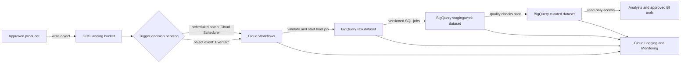

# Architecture Principles

This document defines the core contract and the proposed GCP data-platform overlay. Project-specific diagrams and ownership details belong in `docs/architecture/`; material decisions belong in `docs/adr/`.

## GCP Data Platform (Proposal)

**Status:** Proposed target architecture; not an approved production baseline. The architecture owner must confirm the open decisions below before implementation or production use.

### Purpose and scope

Ingest source files from Google Cloud Storage (GCS), load them into BigQuery, transform them with version-controlled BigQuery SQL, and publish curated BigQuery tables for analytics. Keep the initial path managed and serverless: no custom application service, streaming platform, or AI inference is required.

This proposal defines control boundaries and operating expectations, not project IDs, regions, schemas, schedules, retention periods, or production approvals. Use synthetic or explicitly approved non-production data until classification and data-owner approvals are established.

### Logical architecture and data flow

The orchestration trigger is deliberately undecided. Select one after confirming freshness objectives, expected file volume, producer behavior, and acceptable operational complexity:

- **Scheduled batch:** Cloud Scheduler starts Cloud Workflows on an approved cadence; the workflow discovers or consumes a bounded manifest of unprocessed objects.
- **Event-driven:** GCS object-finalize events are routed through Eventarc to Cloud Workflows; the workflow processes the identified object and its generation.

Do not enable both trigger modes by default. Whichever trigger is selected must use the same validation, load, transformation, quality, and publication steps.

1. An approved producer writes files to a private GCS landing bucket using a documented prefix and file contract. Treat every object and metadata field as untrusted input.
2. Cloud Workflows coordinates a run and records a stable run ID, source URI and object generation, and BigQuery job IDs. Validate the object against the agreed format and contract before loading.
3. A BigQuery load job writes accepted records to an append-oriented raw dataset. Keep source objects immutable for the agreed replay and retention period. Reject incompatible files or schemas without publishing partial curated output; record the reason and restrict access to quarantined data.
4. Version-controlled SQL in `sql/transformations/` builds intermediate tables and curated outputs. SQL in `sql/data_quality/` checks required fields, valid values, completeness, and other contract thresholds before publication.
5. Publish only outputs that pass quality checks. Consumers query the curated dataset, not landing files or raw/staging datasets, unless a separately approved use case requires broader access.
6. Preserve run, source, transformation, and quality-check metadata so an operator can trace a curated result to its inputs and replay a failed batch.

### GCP services and responsibilities

| Service | Responsibility and boundary |
|---|---|
| Cloud Storage | Private landing area for source objects and, if required, a separately restricted quarantine location. Apply lifecycle and retention rules only after data-owner approval. |
| Cloud Workflows | Orchestrates validation, BigQuery load/query jobs, quality gates, and failure handling. It contains control flow, not business transformation logic or credentials. |
| Cloud Scheduler or Eventarc | Starts the workflow using the single trigger mode selected for the workload. Exact trigger configuration remains an open decision. |
| BigQuery | Holds separate raw, staging/work, and curated datasets; performs SQL transformations and quality checks. Keep datasets in a location compatible with the GCS bucket. |
| Cloud IAM and Cloud Audit Logs | Enforce and record access to objects, jobs, datasets, infrastructure, and deployments. |
| Cloud Logging and Cloud Monitoring | Provide run-level logs, operational metrics, dashboards, and actionable alerts without capturing sensitive payloads. |
| Terraform and the approved CI/CD identity | Provision and update GCP resources as reviewed infrastructure as code. Use short-lived workload identity federation for CI where supported. |

### Data contracts and quality

- Define each persisted or shared dataset with an owner, purpose, classification, schema, producer/consumer, access path, quality expectations, compatibility rules, retention, and deletion behavior.
- Agree on accepted formats, naming, schema evolution, required fields, and malformed-file behavior before enabling production ingestion. A breaking schema change requires consumer review and an ADR.
- Make retries safe. Use stable source object generations and deterministic job/run identifiers or an equivalent processed-object ledger to prevent a retried run from silently duplicating published data.
- Bound retries for transient service errors. A failed or invalid batch remains traceable and replayable; it must not be reported as successfully published. Alert an operator when bounded retries are exhausted.
- Keep lineage at least at the source-object, load-job, SQL-version, run, and output-table level. Tune quality thresholds and freshness objectives with data owners rather than inventing defaults here.

### Security and trust boundaries

- **Environment isolation:** use separate GCP projects for DEV, TEST/UAT, and PROD, with distinct buckets, datasets, service identities, configuration, and deployment permissions. Do not copy production data into lower environments without explicit approval and controls.
- **Untrusted input boundary:** producers can write only to their approved landing location. Validate format and schema before downstream use; constrain file size, object prefixes, and accepted formats through the data contract and platform controls.
- **Identity separation:** use distinct identities for infrastructure deployment, workflow execution, data loading/transformation, and human analytics access. Grant only the bucket and dataset permissions required by each identity. Analysts receive curated read access by default; raw and quarantine access requires explicit approval.
- **Credentials:** do not store credentials in Git, SQL, workflow definitions, logs, or artifacts. Prefer short-lived federation for deployment and managed service identities at runtime. Use Secret Manager only if a real secret is required.
- **Data protection:** enable public access prevention and uniform bucket-level access; use platform encryption in transit and at rest, with customer-managed encryption keys only where classification or policy requires them. Define location, retention, deletion, and legal-hold behavior with data owners.
- **Audit and telemetry:** retain access and deployment audit records according to approved policy. Logs may include run IDs, object references, job IDs, counts, and status, but not credentials or sensitive row contents. Apply row-, column-, or policy-tag restrictions when classification requires them.
- **AI boundary:** this data path does not send records, prompts, or outputs to an AI model. Any later AI capability requires an approved use case, data boundary, model/prompt governance, evaluation, and human oversight under `AI_POLICY.md`.

### Environments, delivery, and operations

- Keep DEV, TEST/UAT, and PROD isolated as defined in `docs/deployment/environment-strategy.md`. Use synthetic or approved non-production data in DEV; use controlled representative data in TEST/UAT; restrict PROD to approved identities and data.
- Keep non-secret environment configuration outside code and secrets outside Git. Project IDs, regions, budgets, quotas, service principals, data classifications, and retention periods must be supplied by owners rather than embedded as assumptions.
- Store infrastructure in reviewed Terraform under `infrastructure/terraform/`; compose separate environment roots and state. Review plans before apply, and require explicit human approval for production changes.
- Keep SQL, data contracts, and quality checks in version control. Pull requests run relevant formatting, policy, SQL/schema, security, and infrastructure checks. Promote the reviewed commit/configuration through environments; do not make manual production edits the normal path.
- Monitor workflow outcomes, load/query failures, freshness, row counts, quality failures, and BigQuery/GCS cost or quota signals. Define alert thresholds and runbook ownership before production.
- Recover by correcting the input or SQL, then replaying from retained GCS objects. Define the curated-table rollback method and recovery objectives with consumers before production; a failed validation must leave the last known-good curated output available.

### Repository project structure

The repository is a framework foundation, not a deployed application. These paths describe where future implementation artifacts belong; this architecture change creates none of them.

| Path | Intended responsibility |
|---|---|
| `sql/transformations/` | Ordered, reviewed BigQuery SQL that builds staging and curated tables. |
| `sql/data_quality/` | SQL assertions/checks for data contracts and publication gates. |
| `infrastructure/terraform/` | GCP resources, IAM, datasets, buckets, workflows, and isolated environment roots. |
| `config/dev/`, `config/test/`, `config/prod/` | Non-secret environment-specific values; never credentials. |
| `tests/unit/`, `tests/integration/`, `tests/e2e/` | SQL/contract checks, service-boundary tests, and representative pipeline validation using synthetic or approved data. |
| `docs/architecture/`, `docs/adr/` | Diagrams, ownership/boundary details, and approved material architecture decisions. |
| `policies/`, `agents/`, `skills/` | Normative controls and advisory engineering analysis. |
| `ai/` | Versioned AI assets only if a separately approved AI capability is added; not part of this pipeline. |
| `src/` | No custom runtime is required initially. Add code here only if a validated requirement cannot be met by the managed services and SQL path. |

### AI Engineering Framework demonstration

Demonstrate the framework through its engineering controls, not through an AI component in the ingestion path:

- Policies define the architecture, data, security, AI, and delivery requirements.
- The architecture and security/DevOps agents provide advisory reviews; they do not approve architecture, exceptions, data access, or releases.
- Deterministic CI checks validate repository policy, SQL/contract changes, infrastructure, and security where configured.
- Versioned SQL, data contracts, test results, quality outcomes, deployment records, and runbooks provide reviewable evidence.
- Human owners approve data classification, access, retention, baseline changes, production deployment, and risk exceptions.

AI-assisted work must follow `AI_POLICY.md`: use only approved tools and data locations, avoid exposing sensitive data, and keep human review and deterministic checks authoritative.

### Decisions required before implementation or production

1. Choose scheduled batch or event-driven ingestion based on freshness, volume, producer behavior, and operational ownership.
2. Confirm source owners, consumer needs, file formats, schema contracts, classification, and quality thresholds.
3. Approve GCP project boundaries, locations, budgets/quotas, encryption requirements, identities, and access grants.
4. Set retention, deletion, quarantine, replay, audit, freshness, alerting, and recovery objectives.
5. Confirm deployment ownership, required CI checks, and production approvers.

### Applicable principles

This proposal follows `ARCH-001` through `ARCH-007`, `DATA-001` through `DATA-005`, `DATA-CON-001` through `DATA-CON-004`, and applicable `SEC-*` and `DEVOPS-*` policies. It does not approve or modify `docs/architecture/baseline.yaml`. Material decisions affecting boundaries, data, security, cost, or operations require the architecture owner’s review and an ADR.

The detailed source of truth is under `policies/architecture/`: `architecture-principles.md` and `dependency-principles.md`. Their stable IDs are intended for future automated enforcement.

| Principle | Requirement | Automated check | Human decision |
|---|---|---|---|
| Clear boundaries | Separate domains, infrastructure, policy, and delivery concerns. | Repository structure validation; dependency checks. | Approve boundary changes in review. |
| Explicit dependencies | Dependencies are declared, justified, pinned or constrained, and scanned. | Dependency and license checks. | Approve exceptions and major upgrades. |
| Secure interfaces | APIs validate input, authenticate callers, authorize actions, and avoid leaking sensitive data. | SAST and policy checks. | Review trust-boundary changes. |
| Data ownership | Each dataset has an owner, classification, contract, retention, and access path. | Data-policy and contract checks where configured. | Approve classification and retention. |
| Cloud neutrality | Core rules do not depend on one cloud vendor. | Forbidden-provider checks in core paths. | Approve stack overlays. |
| Observable systems | Services expose health, logs, metrics, traces where applicable, and actionable alerts. | Required observability documentation. | Set service-level objectives. |
| Reproducible delivery | Build once, identify artifacts by commit, and promote the same artifact. | CI/CD workflow checks. | Approve release and rollback policy. |

## Allowed patterns
- Modular monoliths or services with explicit ownership.
- Versioned APIs and data contracts.
- Infrastructure represented as reviewed code.
- Synchronous calls for bounded work and asynchronous messaging for durable workflows.
- Provider-specific implementations behind stack-overlay boundaries.

## Prohibited patterns
- Shared mutable databases across unrelated domains without an approved contract.
- Secrets or environment-specific credentials in source control.
- Unbounded synchronous chains, hidden network calls, or undocumented data copies.
- Vendor-specific code in core policy and governance paths.
- Architecture changes without an ADR when they affect boundaries, data, security, cost, or operations.

## Architecture baseline
The architecture boundaries are recorded in `docs/architecture/baseline.yaml` (`ARCH-BL-001` to `ARCH-BL-004`); its current status is `draft`, so this proposal is not an approved baseline. The baseline locks boundaries, not developer decisions. `bash scripts/validate-baseline.sh` classifies each PR as `NO_BASELINE_IMPACT`, `BASELINE_IMPACT`, or `ARCHITECTURE_CHANGE`. An `ARCHITECTURE_CHANGE` requires an ADR with `Baseline impact: change` once the baseline is approved; agents advise, CI enforces the deterministic rule, and the architecture owner decides.

## ADR triggers
Create an ADR for a new service, external dependency, data store, public API, model/provider, RAG source, guardrail change, infrastructure pattern, security exception, or breaking change.