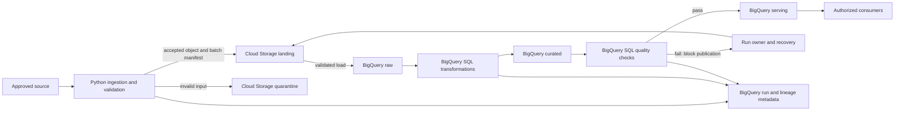

# GCP Data Platform Architecture

## Purpose and status

This document defines the proposed project architecture for a batch-oriented GCP data platform. It is the project-specific stack overlay on the technology-neutral AI Delivery Foundation: the Foundation owns engineering, security, governance, and delivery policy; this project architecture selects the data-platform components and their boundaries.

The selected data stack is Cloud Storage, BigQuery, Python, and SQL. This document records the proposed baseline for implementation and review; it does not provision infrastructure or replace required human architecture approval and ADRs for material architecture decisions.

## Architecture principles

The platform applies the Foundation principles without weakening them:

- **ARCH-001, ARCH-002 — Separation of concerns and explicit boundaries:** ingestion, storage, transformation, quality, and metadata responsibilities are distinct; inputs, outputs, ownership, and failure handling are explicit.
- **ARCH-003 — API and contract compatibility:** persisted and shared datasets have versioned contracts, validation, compatibility, and deprecation rules.
- **ARCH-004 — Resilience and scalability:** ingestion is replayable and idempotent; failures are visible and recoverable; capacity and workload limits are set by the owning team.
- **ARCH-005 — Observability:** pipeline runs expose actionable status, quality and freshness evidence, operational metrics, ownership, and runbooks.
- **ARCH-006 — Infrastructure as code:** production resources and configuration are managed through reviewed infrastructure as code; this document does not prescribe its implementation.
- **ARCH-007 — Architecture decisions:** human owners approve material boundary, data, security, and operational decisions and record required ADRs.
- **DATA-001 through DATA-005; DATA-CON-001 through DATA-CON-004; DATA-CLS-001 through DATA-CLS-004:** data is minimized, protected, classified, contracted, quality-checked, traceable, retained, and deleted according to its purpose and risk.
- **SEC-001 through SEC-005; SEC-IAM-001 through SEC-IAM-004:** untrusted inputs are validated; identities are separated and least-privileged; sensitive data and operational evidence are protected and auditable.

The authoritative requirements are in `policies/architecture/architecture-principles.md`, `policies/data/`, and `policies/security/`. Environment separation and operational monitoring follow `docs/deployment/environment-strategy.md` and `docs/observability.md`.

## Component and technology choices

| Component | Technology | Responsibility | Boundary |
|---|---|---|---|
| File landing and quarantine | Google Cloud Storage | Receive approved batch files, retain source objects for replay according to policy, and isolate invalid or rejected files. | Object storage is not the transformation engine or the consumer-facing analytical store. |
| Analytical storage and execution | BigQuery | Hold source-aligned, curated, serving, quality-result, run, and lineage datasets; execute transformation and validation SQL. | Dataset access is granted by environment, classification, and consumer purpose. |
| Ingestion and pipeline control | Python | Read from approved sources, validate input envelopes and schemas, create or verify batch manifests, load objects to BigQuery, invoke SQL steps, gate publication, and write operational metadata. | Python handles I/O and control flow; business transformations and set-based quality rules belong in SQL. The execution runtime is a project deployment choice, not selected here. |
| Transformation, quality, and metadata operations | SQL in BigQuery | Transform data, validate business and technical rules, and query or persist run, quality, and lineage records. | SQL changes are reviewed and versioned with the project; compatible schema evolution is required. |

No separate orchestration or catalog/lineage service is selected. Pipelines are started manually or by a trigger supplied by the deployment environment. Scheduling, runtime hosting, source connectors, and consumer interfaces remain project decisions and must be reviewed before implementation; this architecture does not assume a particular additional GCP product.

## Logical data zones

The platform uses logical zones, implemented as environment-separated Cloud Storage locations and BigQuery datasets:

1. **Landing (Cloud Storage):** batch objects arrive in a controlled environment-specific location. Preserve the original object and its generation/identity for traceability and replay. A batch manifest records the source, arrival, schema or contract version, and file identity without copying sensitive payloads into logs.
2. **Quarantine (Cloud Storage):** files that fail transport, envelope, or schema checks are isolated from normal processing. They are not loaded or published until corrected or explicitly handled under an approved recovery procedure.
3. **Raw (BigQuery):** validated source-aligned records are loaded with batch/run identifiers and source references. This zone preserves provenance and supports controlled reprocessing; it is not a consumer-facing contract by default.
4. **Curated (BigQuery):** SQL produces standardized, documented datasets with agreed types, keys, semantics, and quality expectations.
5. **Serving (BigQuery):** SQL publishes consumer-facing, versioned datasets only after required transformations and blocking quality checks succeed.
6. **Operations and metadata (BigQuery):** SQL and Python maintain pipeline-run status, quality results, and lineage records. Access is limited to operational and data-governance purposes.

Zone names describe logical responsibilities, not a required physical bucket or dataset naming convention. Owners define physical layout, partitioning, retention, and deletion based on volume, classification, cost, and contract requirements.

## Data flow

1. An approved producer supplies a batch through a project-approved source interface. Python treats the source, file names, contents, and declared schema as untrusted.
2. Python validates the file envelope and contract, assigns a stable run/batch identifier, and writes accepted objects and a minimal manifest to the environment's Cloud Storage landing area. Invalid inputs are isolated in quarantine with a failure reason that does not expose sensitive records.
3. Python submits BigQuery load jobs for accepted objects. Raw records retain batch identifiers and object references. Load operations are idempotent for a given source object identity and generation, contract version, and run policy; retries must not silently duplicate data.
4. Versioned SQL transforms raw data into curated datasets. Transformations record their source revision and the input/output datasets.
5. SQL quality checks evaluate the declared contract and business rules. Python records each check's result and controls the run state. A failed blocking check prevents the affected serving dataset or partition from being published; a warning does not bypass a contract's failure policy.
6. After required checks pass, SQL publishes the compatible serving output. Python and SQL write run, quality, and lineage evidence to the BigQuery operations/metadata datasets.
7. Authorized consumers read serving datasets under their approved contract and access role. They do not read landing, quarantine, raw, or operational metadata unless explicitly authorized.

## Data contracts, quality, and lineage

### Contracts and quality gates

Every shared, persisted, externally consumed, decision-supporting, or model-consumed dataset has a versioned contract. The contract identifies its producer and consumers, owner, purpose, classification, schema, access path, retention/deletion requirements, compatibility policy, and quality expectations.

Quality rules are defined with the data owner and consumer and implemented at the appropriate boundary:

- Python validates file readability, required metadata, declared schema/contract version, and basic input shape before loading.
- BigQuery SQL checks required values, types and semantics, uniqueness, valid ranges, referential rules where applicable, completeness, and freshness.
- Each rule defines its scope, threshold or expected value, severity, blocking or warning behavior, and owner. Results are stored with the run identifier, dataset/partition, rule version, measured result, threshold, and outcome.
- Blocking failures prevent publication. Recovery is an explicit, owned action: correct or quarantine the source, rerun idempotently, and retain the original failure and subsequent result as evidence.

Breaking schema or semantic changes require consumer review, a compatibility/deprecation plan, and an ADR where required by Foundation policy.

### Lineage and provenance

Python and SQL maintain lineage in BigQuery operations/metadata datasets. Each run records a stable run identifier, source object identity and generation or upstream dataset, contract version, start/end status, input/output tables, transformation SQL revision (and content hash where available), quality outcome, and any retry/recovery relationship. Records link to Cloud Storage object references rather than duplicating source payloads.

Dataset-level lineage records the input-to-output relationships for each run. Column-level lineage is recorded explicitly for material transformations as source/target column relationships with the transformation reference; it is not inferred automatically for arbitrary SQL. Owners update and review these mappings with the SQL and contract changes. Consumers and operators can use the records to trace a serving value back to its source batch and transformation.

Lineage and quality metadata are governed data: assign an owner, purpose, classification, access path, and retention. Do not put credentials, full sensitive records, or unnecessary personal data in manifests, SQL comments, logs, or metadata.

## Security, environments, and access

- Treat external sources and files as untrusted; validate them before they cross into BigQuery or become available to consumers.
- Separate DEV, TEST/UAT, and PROD storage locations, BigQuery datasets, configuration, runtime identities, deployment permissions, and audit evidence. DEV uses synthetic or approved non-production data; restricted production data does not flow to lower environments without explicit approval and controls.
- Use distinct, owned human, runtime, and deployment identities with least-privilege access. Grant file and dataset access only to the identities and consumers that need it; production access receives periodic review.
- Use approved encryption in transit and at rest and approved secret references. Do not store long-lived credentials in source, SQL, object manifests, logs, or artifacts.
- Enforce dataset and object access according to classification and purpose. Apply masking or other approved handling before any authorized lower-trust use.
- Minimize operational logs and metadata. Record identifiers, counts, statuses, and error categories rather than payloads; redact sensitive values and keep audit evidence access-controlled.
- Changes to identity, exposure, classification, retention, or trust boundaries receive the security, privacy, and data-owner reviews required by Foundation policy.

## Reliability and operations

- **Idempotency and replay:** retain source object identity and generation, batch/run identifiers, and load/transform status. Reprocessing the same input is deterministic under the documented run policy and does not create untracked duplicate publication.
- **Failure handling:** distinguish invalid input, quality failure, and transient platform/job failure. Retry only bounded transient failures; quarantine invalid data; block publication on required quality failures; expose a terminal status and owner for every failed run.
- **Publication safety:** load and transform into non-consumer-facing raw/curated targets first. Publish or replace serving output only after its required checks succeed and schema compatibility is established.
- **Recovery:** preserve sufficient source and metadata evidence for an authorized replay within retention limits. A recovery run links to the original run and does not erase prior failure evidence.
- **Observability:** expose run success/failure, duration, input/output volume, freshness, retry counts, quality outcomes, and BigQuery job errors through the selected execution environment's approved monitoring and logging facilities. Assign alerts, service/data owners, escalation paths, and runbooks before production use.
- **Capacity and cost:** owners define expected volume, freshness, query/load limits, retention, and cost controls before production; tune storage layout and BigQuery execution within those agreed requirements.

The scheduler, runtime host, alerting implementation, and service-level objectives are not selected here. Their choices must preserve these boundaries and be documented before production deployment.

## Delivery and deployment

Version Python ingestion components, SQL transformations, contracts, and quality rules with the project. Validate changes through the Foundation's applicable build, quality, security, and governance gates. Build an immutable artifact once, identify it by commit, and promote the same artifact through DEV, TEST/UAT, and PROD; keep environment configuration and secret references external to the artifact. Manage production resources through reviewed infrastructure as code. Require the defined human production approval, retain deployment evidence, and maintain a rollback and data-recovery procedure before production use.

## Architecture boundaries and ownership

**Included:** batch-oriented ingestion into Cloud Storage and BigQuery; Python I/O and pipeline control; SQL-based BigQuery transformations, quality gates, and lineage metadata; logical data zones; contracts, security, environment, recovery, and operational responsibilities.

**Outside this architecture:** a particular scheduler/orchestrator, Python hosting runtime, source-specific connector, streaming/event ingestion, BI/API/ML consumer implementation, catalog service, automatic SQL lineage parser, and detailed infrastructure resource configuration. Each is a separate project decision; adding a managed service, data store, or new system boundary requires the Foundation review and ADR process.

Data producers own source semantics and delivery contracts. Data owners own classification, quality thresholds, retention, and access approval. The platform owner owns ingestion and operational controls. Transformation owners maintain SQL, contracts, and lineage mappings. Consumer owners validate compatibility and use serving data only through the agreed contract. Human owners remain accountable for access approval, exceptions, production readiness, and architecture decisions.
