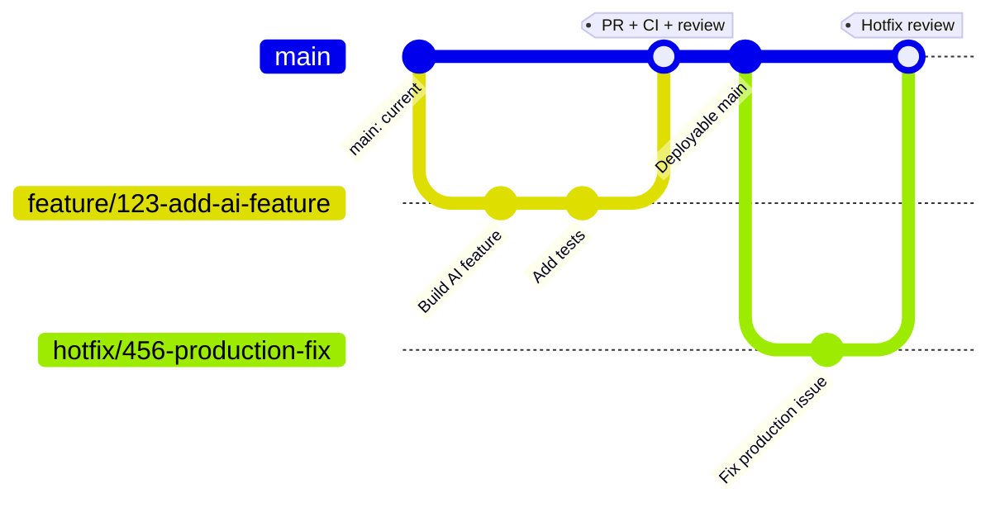

# Agentic Development and DevOps Framework

A reusable framework for agentic development with GitHub Copilot, with clear guidance for architecture, security, DevOps, and human accountability.

The goal is simple: make the right engineering practices the easiest way to build and deliver agentic software.

## Overview

This repository is a technology-neutral reusable project skeleton, not an application. It provides a repeatable foundation for:

- Repository structure and shared Copilot context
- Engineering, architecture, DevOps, security, data, and AI policies
- Developer workflow, branching, pull requests, ownership, and risk review
- Deterministic CI and policy enforcement
- Environment promotion, IaC boundaries, and rollback hooks
- Custom advisory agents and reusable analysis skills

It standardizes the starting point without removing engineering judgment. Project teams still choose their stack, platform, data boundaries, model providers, thresholds, and accountable owners.

## Core Problem and Idea

Agentic projects move quickly, but speed can create inconsistent repository structures, undocumented architecture, weak security boundaries, uneven CI/CD, and unclear ownership of AI-generated changes. A team of ten developers needs a shared way to plan, build, review, and ship without turning every feature into a platform project.

The idea is to put the guardrails in the repository: shared Copilot context, a version-controlled architecture baseline, reusable review agents and skills, deterministic CI checks, and explicit human approval points. Copilot helps with discovery and implementation; CI and humans remain authoritative for correctness, risk, architecture, and release decisions.

## Core Principle

> **Lock the architecture and engineering boundaries, not every developer decision.**

A greenfield project records its approved architecture baseline at inception in [docs/architecture/baseline.yaml](docs/architecture/baseline.yaml). Developers are free to implement features within those boundaries. A change that crosses an approved boundary is detected and routed for review, and a meaningful architectural deviation requires an ADR and human approval.

The baseline ships as a technology-neutral `draft`. The architecture owner completes it and sets `status: approved` before the ADR requirement is enforced.

## Framework Idea

```text
Project
	-> Repository Skeleton
	-> Engineering Policies and Architecture Baseline
	-> Developer Workflow (feature branch -> pull request)
	-> Architecture Baseline Guard
	-> CI and Policy Enforcement
	-> Relevant Agents and Skills
	-> Human Review
	-> Merge
	-> CD, Environments, and IaC
	-> Deployment
```

Engineering standards are embedded in normal development and review rather than treated as a separate compliance activity.

## Framework at a Glance

Policies say what must be true; the [Developer DevOps Golden Path](docs/architecture/devops-golden-path-guide.html) says what a developer does, from starting a feature to getting it safely into production.

```text
Understand requirement -> check architecture and policies -> feature branch -> develop and test
-> bash scripts/check.sh -> commit -> pull request -> CI -> agent review -> human review -> merge
-> build once -> DEV -> TEST/UAT -> production approval -> PROD -> verify or roll back
```

- **Greenfield:** a new project starts from this skeleton and follows the path from the first commit.
- **Brownfield:** an existing project is not rebuilt. The foundation provides assessment and scaffold tooling for a progressive adoption PR, while preserving the project's existing architecture, CI, security, ownership, and deployment decisions.
- **Minimum GitHub setup:** protected `main`, `CODEOWNERS`, the PR template, CI gates, and environment separation with human production approval. An administrator configures GitHub settings from [docs/administrator-setup.md](docs/administrator-setup.md).
- **Who does what:** CI enforces deterministic rules, agents provide advisory findings, and humans approve merges, exceptions, architecture changes, and production.

The detailed, visual guide is [docs/architecture/devops-golden-path-guide.html](docs/architecture/devops-golden-path-guide.html).

## Foundation commands

The repository includes a `/foundation` Agent Skill for applying this framework to new and existing projects:

```text
/foundation assess <path>   read-only repository assessment
/foundation init <path>     plan a new project configuration
/foundation adopt <path>    plan adoption without overwriting project conventions
/foundation scaffold <path> plan or add minimal/full foundation files
/foundation check <path>    run foundation validators and the Plumbline gate
/foundation policy <paths>  identify relevant policy areas
/foundation baseline <path> inspect the architecture baseline
/foundation protect         show administrator branch-protection requirements
/foundation report <path>   summarize adoption status
```

Use the [new-project onboarding guide](docs/onboarding/README.md) for greenfield setup and the [existing-project adoption runbook](docs/onboarding/existing-project.md) for brownfield repositories.

When an agent skill is unavailable, use the dependency-free helper directly, for example:

```text
python skills/foundation/foundation.py assess .
python skills/foundation/foundation.py check .
python skills/foundation/foundation.py scaffold "C:/path/to/existing project" --mode minimal
```

## Framework Architecture

```text
POLICY
	 -> SKILL
	 -> AGENT
	 -> WORKFLOW
	 -> CI/CD
	 -> HUMAN
```

- **Policy** defines what must be true.
- **Skill** defines how one focused engineering analysis is performed.
- **Agent** selects applicable skills and provides contextual reasoning.
- **Workflow** defines when checks and reviews happen.
- **CI/CD** performs deterministic validation and delivery controls.
- **Human** remains accountable for risk, exceptions, production, and other defined decisions.

Agents complement deterministic engineering controls. They do not replace CI/CD or human accountability.

The Architecture Baseline fits this model without adding a new layer:

| Element | Role |
|---|---|
| Policy | Defines what must be true. |
| Baseline | Defines the project's approved architectural boundaries. It complements policy and does not replace it. |
| Skill | Explains how a review or check is performed. |
| Agent | Performs contextual analysis and recommends; it never decides. |
| Workflow | Determines when checks happen. |
| CI | Performs deterministic enforcement. |
| Human | Makes and approves significant architecture decisions. |

## Architecture Baseline

The baseline in [docs/architecture/baseline.yaml](docs/architecture/baseline.yaml) records only important project-level boundaries. Its policy is [policies/architecture/architecture-baseline.md](policies/architecture/architecture-baseline.md) (`ARCH-BL-001` to `ARCH-BL-004`).

| Boundary ID | Area |
|---|---|
| `BL-APP` | Application architecture |
| `BL-COMP` | Major components and service boundaries |
| `BL-TECH` | Technology and platform choices |
| `BL-DATA` | Data architecture |
| `BL-AI` | AI integration architecture |
| `BL-MODEL` | AI model provider and family boundary |
| `BL-SEC` | Security and IAM boundaries |
| `BL-DEPLOY` | Deployment architecture |
| `BL-ENV` | Environment structure |
| `BL-CICD` | CI/CD architecture |
| `BL-REPO` | Repository boundaries and ownership |

Each boundary states what is **approved** (`baseline`) and what stays **flexible** (`flexible`), for example a model version bump inside the approved model family. The baseline does not govern implementation detail, and it is not a version-management system.

## Architecture Baseline Guard

The guard is a deterministic script, [scripts/validate-baseline.sh](scripts/validate-baseline.sh), run with `bash scripts/validate-baseline.sh`. It validates the baseline and compares the files changed in a PR with each boundary's `impact_paths` and `change_paths`.

```text
NO_BASELINE_IMPACT
        |
        v
Normal PR workflow

BASELINE_IMPACT
        |
        v
Relevant agent and owner review (CI does not fail)

ARCHITECTURE_CHANGE
        |
        v
ADR / architecture review
        |
        v
Human approval
```

- **Where it runs:** the "Detect architecture baseline impact" step in [policy.yml](.github/workflows/policy.yml) on pull requests. The scenario tests are in [scripts/test-baseline-guard.sh](scripts/test-baseline-guard.sh) (`bash scripts/test-baseline-guard.sh`).
- **What it prints:** the component, baseline, change, changed files, classification, and the required reviews, including the agents named by the matched boundaries.
- **What it enforces:** an `ARCHITECTURE_CHANGE` needs an ADR with `Baseline impact: change`, and a change to `baseline.yaml` also needs `Baseline update: yes`. The guard fails on a missing or malformed ADR only when the baseline is `approved`; while it is `draft` it warns.
- **What it does not do:** it does not judge whether a change is acceptable, run agents, or approve anything. Matching is path-based.

The guard is one check inside CI, not CI itself: CI is the pipeline that runs all deterministic checks.

### Architecture changes

A normal feature needs no ADR. An architecture change uses the existing ADR mechanism ([docs/adr/](docs/adr/), [template](docs/adr/template.md)).

| Change | Example path | Guard result | Review |
|---|---|---|---|
| Add business feature | `src/customer_summary.py` | `NO_BASELINE_IMPACT` | Normal development |
| Replace approved database | `infrastructure/database/` | `ARCHITECTURE_CHANGE` | Architecture + Security & DevOps agents, ADR, human approval |
| Change IAM boundary | `infrastructure/iam/` | `BASELINE_IMPACT` | Security & DevOps + Architecture agents, security and architecture owners |
| Change AI model | `ai/models/` | `BASELINE_IMPACT` | AI Engineering + Architecture agents, AI owner |
| Change prompt wording only | `ai/prompts/` | `NO_BASELINE_IMPACT` unless it is a protected `*contract*` prompt | Normal review |
| Change deployment architecture | `infrastructure/` (Terraform, `cd.yml`) | `ARCHITECTURE_CHANGE` | Security & DevOps + Architecture agents, ADR, human approval |

## Repo Layout

```text
.
├── .github/
│   ├── CODEOWNERS
│   ├── workflows/
│   ├── BRANCHING.md
│   ├── definition-of-done.md
│   └── pull_request_template.md
├── agents/
├── skills/
├── policies/
├── docs/
├── src/
├── tests/
├── ai/
├── infrastructure/
├── config/
├── scripts/
├── AGENTS.md
├── ARCHITECTURE.md
├── CONTRIBUTING.md
├── SECURITY.md
├── AI_POLICY.md
└── DATA_POLICY.md
```

| Path | Purpose |
|---|---|
| `policies/` | Normative engineering policies with stable IDs |
| `agents/` | Four advisory custom agent contracts |
| `skills/` | Fourteen reusable analysis skill contracts |
| `docs/` | Architecture, workflow, governance, deployment, IaC, ADR, and review guidance |
| `docs/architecture/baseline.yaml` | Approved architecture baseline |
| `src/` | Application source and service contracts |
| `tests/` | Unit, integration, and end-to-end test locations |
| `ai/` | Model, prompt, evaluation, and guardrail assets |
| `infrastructure/` | IaC modules and isolated environment locations |
| `config/` | Non-secret project and CI configuration |
| `scripts/` | Bootstrap, validation, security, artifact, deployment, and rollback hooks, including the Baseline Guard |
| `.github/` | GitHub governance and workflow integration |

## Policies

Policies are the source of engineering intent. They use stable identifiers, normative `MUST`, `SHOULD`, and `MAY` language, exception requirements, human decisions, and automation candidates.

Policy domains include:

- Repository: `RP-*`
- Architecture and dependencies: `ARCH-*`, `ARCH-DEP-*`, `ARCH-BL-*` (architecture baseline)
- DevOps and delivery: `DEVOPS-*`
- Security and IAM: `SEC-*`, `SEC-SEC-*`, `SEC-IAM-*`
- Data: `DATA-*`, `DATA-CLS-*`, `DATA-CON-*`
- AI: `AI-*`, `AI-MOD-*`, `AI-PRM-*`, `AI-EVAL-*`, `AI-AGT-*`

For example, `SEC-SEC-001` prohibits secrets in Git, while `AI-AGT-001` keeps agents advisory. Policy exceptions require documented risk, mitigation, owner, approver, and expiry. See [policies/](policies/) and [docs/governance/exceptions.md](docs/governance/exceptions.md).

## How a Feature Flows (End to End)

```text
Work Item
	-> Feature Branch
	-> Development
	-> Local Validation
	-> Commit
	-> Push
	-> Pull Request
	-> Automated Checks
	-> Human Review
	-> Approval
	-> Merge
	-> Deployment
```

### Branching Strategy

This repository uses a simple pull-request branching model. `main` is protected and always represents the releasable codebase. Developers create a short-lived branch for one work item, keep it current with `main`, and merge it only after checks and required reviews pass.



Use these branch names:

- `feature/<issue>-<short-name>` for new capabilities
- `bugfix/<issue>-<short-name>` for corrective changes
- `hotfix/<incident>-<short-name>` for urgent production recovery

Direct commits and force pushes to `main` are prohibited. Squash merge is the default for focused changes, and merged branches should be deleted. Release branches are not part of the default model; introduce one only with an ADR and release-owner approval. See [.github/BRANCHING.md](.github/BRANCHING.md) for the complete rules.

The workflow is supported by:

- Branch rules in [.github/BRANCHING.md](.github/BRANCHING.md)
- PR governance in [.github/pull_request_template.md](.github/pull_request_template.md)
- Ownership in [.github/CODEOWNERS](.github/CODEOWNERS) and [docs/governance/ownership.md](docs/governance/ownership.md)
- Completion criteria in [.github/definition-of-done.md](.github/definition-of-done.md)
- Risk classification in [docs/governance/risk-classification.md](docs/governance/risk-classification.md)
- Review routing in [docs/governance/approval-matrix.md](docs/governance/approval-matrix.md)
- Architecture baseline impact and ADRs in [docs/developer-workflow.md](docs/developer-workflow.md) and [docs/adr/](docs/adr/)
- Exceptions in [docs/governance/exceptions.md](docs/governance/exceptions.md)

The end-to-end sequence is:

1. **Issue:** define the user outcome, acceptance criteria, risk, and likely policy or architecture impact.
2. **Branch:** create `feature/<issue>-<name>`, `bugfix/<issue>-<name>`, or `hotfix/<incident>-<name>` from current `main`.
3. **Plan:** use the repository context, applicable policies, the architecture baseline, and Copilot to identify the smallest implementation and test plan.
4. **Implement:** make the change in the selected stack overlay, keeping secrets out of source control and documenting material decisions.
5. **Validate locally:** run `bash scripts/check.sh`, targeted tests, and `bash scripts/validate-baseline.sh` when architecture paths may be affected.
6. **Open a PR:** complete the PR template, disclose AI assistance, classify risk, link evidence, and request CODEOWNER and specialist reviews.
7. **Run CI:** deterministic repository, policy, quality, security, architecture, and applicable infrastructure checks execute on the pull request.
8. **Review:** the relevant advisory agents provide evidence-based recommendations; CODEOWNERS and required human specialists make the accountable decisions.
9. **Merge:** merge only after required checks and human approvals pass on protected `main`.
10. **Deliver:** build one immutable artifact, promote it through DEV and TEST/UAT, obtain production approval, verify health, and retain rollback evidence.

## Copilot in the Daily Workflow

Use Copilot as a fast engineering partner inside the workflow, not as an approval system:

- **Understand:** ask Copilot to summarize the issue, identify relevant files, policies, owners, tests, and architecture-baseline paths. Verify its references against the repository.
- **Plan:** ask for a small implementation plan and likely failure cases. Keep the plan aligned with the issue, selected stack, and approved architecture.
- **Build:** use Copilot to draft focused code, tests, documentation, and configuration. Treat generated output as untrusted until reviewed.
- **Review locally:** ask Copilot to inspect the diff for correctness, security, data handling, observability, duplication, and missing tests. Run deterministic checks yourself.
- **Prepare the PR:** use Copilot to summarize the change, map policy IDs, identify risk, and check the PR template. Do not let it invent evidence or approvals.
- **Respond to review:** use Copilot to explain CI failures and propose fixes, then confirm the fix with the same deterministic check that failed.
- **Keep boundaries clear:** Copilot may recommend and draft; CI enforces deterministic rules; human owners approve architecture changes, exceptions, risk acceptance, merges, and production.

## CI/CD and Enforcement

### Deterministic checks

The foundation also vendors a pinned, standard-library-only Plumbline profile. `bash scripts/check.sh` and the
quality workflow run `scripts/plumbline-check.sh`, which detects common AI-generated defects and risky change shape.
The profile is deliberately scoped to complement, not replace, the foundation's policy validators and YAML
architecture baseline. The companion `scripts/plumbline-guard.sh` can be registered as an agent shell-tool hook to
block merge, approval, force-push, hook-bypass, and protected-branch commands. The guard requires Python 3.10 or
later, available as `python3`, `python`, or `py -3`.

The current core includes repository and policy validation, high-confidence secret checks, PR/risk validation hooks, artifact digest verification, and conditional hooks for dependencies, SAST, IaC, containers, tests, and coverage.

The actual GitHub workflows are:

- [ci.yml](.github/workflows/ci.yml): build and baseline repository validation
- [policy.yml](.github/workflows/policy.yml): repository, policies, exceptions, PR metadata, risk paths, and architecture baseline impact
- [security.yml](.github/workflows/security.yml): secret checks and conditional security assets
- [quality.yml](.github/workflows/quality.yml): lint and tests
- [infrastructure.yml](.github/workflows/infrastructure.yml): conditional Terraform validation
- [cd.yml](.github/workflows/cd.yml): artifact build, verification, environment promotion, and overlay hooks

No application language, dependency manifest, Dockerfile, or Terraform implementation exists in the core, so stack-specific checks report conditional or `NOT CONFIGURED` status until an overlay is selected. Full GitHub branch protection, CODEOWNER enforcement, environment reviewers, secrets, OIDC, and cloud deployment remain administrator or project-overlay configuration.

### AI-assisted checks

Agents may provide architecture reasoning, contextual security review, AI design review, code-quality reasoning, trade-off analysis, and recommendations, including baseline impact analysis for changes the Baseline Guard flags.

If a rule can be reliably checked deterministically, CI is preferred over an AI agent.

## Custom Agents

The repository contains four custom domain agents. They are repository contracts, not replacements for GitHub Copilot or an autonomous runtime. There is no separate baseline agent: the Baseline Guard reports which of these four agents should review a change.

| Agent | Responsibility |
|---|---|
| [Architecture Agent](agents/architecture/AGENT.md) | Architecture, dependencies, APIs, boundaries, data contracts, ADRs |
| [Security & DevOps Agent](agents/security-devops/AGENT.md) | Security, IAM, secrets, CI/CD, IaC, environments, deployment, rollback |
| [AI Engineering Agent](agents/ai-engineering/AGENT.md) | Models, prompts, RAG, evaluations, guardrails, cost, AI risk |
| [Code Quality Agent](agents/code-quality/AGENT.md) | Maintainability, tests, complexity, duplication, documentation, errors |

## Skills

Skills are reusable analysis contracts. Agents orchestrate relevant skills rather than running every skill for every change.

```text
Architecture Agent
	├── Architecture Review
	├── Dependency Analysis
	└── ADR Review

Security & DevOps Agent
	├── Secret Review
	├── IAM Review
	├── Dependency Review
	├── CI Review
	├── CD Review
	└── IaC Review

AI Engineering Agent
	├── Model Review
	├── Prompt Review
	└── Evaluation Review

Code Quality Agent
	├── Code Review
	└── Test Review
```

The 14 skill contracts and stable IDs are under [skills/](skills/). Each defines its purpose, applicable policies, trigger, inputs, procedure, expected output, severity/confidence guidance, and human review requirements. Architecture Review (`ARCH-SK-001`) includes the baseline impact review procedure.

## Change-Aware Agent Routing

Routing is implemented as a configurable contract in [config/ai/agent-routing.yaml](config/ai/agent-routing.yaml):

```text
src/ and tests/       -> Code Quality + Architecture
infrastructure/       -> Security & DevOps (+ Architecture when the Baseline Guard flags a boundary)
ai/ and evaluations/  -> AI Engineering + Security & DevOps (+ Architecture for model and guardrail boundaries)
data contracts        -> Architecture + Security/DevOps + AI where relevant
.github/workflows/    -> Security & DevOps
policies/ and ADRs    -> Architecture
docs/architecture/baseline.yaml -> Architecture Agent, then human review
```

The Baseline Guard (`bash scripts/validate-baseline.sh`) adds the agents named by each matched baseline boundary and classifies the PR as `NO_BASELINE_IMPACT`, `BASELINE_IMPACT`, or `ARCHITECTURE_CHANGE`. A baseline change goes to the Architecture Agent, any specialist agent the ADR's affected boundaries call for, and a human reviewer.

The routing file is advisory configuration. It does not itself execute agents or call a model.

## Human-in-the-Loop

Agents are advisory and read-only by default. They must not:

- Approve production deployments
- Approve policy exceptions or risk acceptance
- Merge pull requests autonomously
- Grant IAM permissions
- Bypass CI/CD or security controls
- Approve their own findings
- Make high-risk production decisions without required human approval
- Approve architecture changes
- Modify the approved architecture baseline

```text
CI      = deterministic enforcement
Agents  = contextual analysis and recommendation
Human   = architectural decision authority
```

The architecture owner approves every `ARCHITECTURE_CHANGE`, ADR, and baseline edit; specialist owners approve per [docs/governance/approval-matrix.md](docs/governance/approval-matrix.md).

```text
Agent Finding
			-> Human Review
			-> Decision
				 ├── Accept
				 └── Reject / Challenge
			-> Required action
```

The standard finding contract is defined in [docs/agent-output.md](docs/agent-output.md). It includes finding ID, agent, skill, severity, confidence, policy ID, file/line, evidence, recommendation, human action, and disposition.

## Security Principles

The repository defines least privilege, external secret management, dependency security, secure CI/CD, production protection, sensitive-data handling, prompt-injection awareness, and auditability in [SECURITY.md](SECURITY.md), [AI_POLICY.md](AI_POLICY.md), and [policies/ai/agent-governance.md](policies/ai/agent-governance.md).

Agent governance specifically requires read-only default operation, no production credentials, no unrestricted writes, untrusted-context handling, versioning, evidence, and human escalation.

## How We Build a Greenfield Project

1. Create a new repository from this skeleton; follow the detailed [new-project onboarding guide](docs/onboarding/README.md).
2. Read [AGENTS.md](AGENTS.md), [CONTRIBUTING.md](CONTRIBUTING.md), and the applicable policies.
3. Run `bash scripts/setup.sh` and configure [PROJECT.yaml](PROJECT.yaml).
4. Replace placeholders in [.github/CODEOWNERS](.github/CODEOWNERS) with approved team or role handles.
5. Select a language, cloud, data platform, and deployment overlay.
6. Define project architecture, ownership, contracts, environments, and AI capabilities, and have the architecture owner complete and approve [docs/architecture/baseline.yaml](docs/architecture/baseline.yaml).
7. Configure GitHub branch protection, environment reviewers, secrets, and OIDC using [docs/administrator-setup.md](docs/administrator-setup.md).
8. Add application code, tests, infrastructure, model assets, prompts, evaluations, and guardrails.
9. Run the documented local checks before opening a PR.
10. Follow the review, approval, artifact, and promotion path.

Standardize the core policies, repository governance, agent/skill contracts, and workflow shape. Customize project source, stack overlays, environment configuration, owners, data contracts, model choices, thresholds, and deployment adapters.

## Technology-Neutral Core

The core does not assume Python, Node.js, Java, .NET, a cloud provider, or an LLM provider.

```text
Golden Path Core
			├── Language and runtime overlay
			├── Cloud and deployment overlay
			├── Data platform overlay
			└── Project-specific application and AI configuration
```

The repository currently contains no provider-specific infrastructure or application stack. Overlays add concrete build, test, dependency, IaC, container, model, and deployment behavior without weakening the core contracts.

## Current Scope and Roadmap

Currently provided:

- Repository standards and reusable structure
- Engineering, DevOps, security, data, and AI policies
- Developer workflow and repository governance
- Core deterministic CI and policy validation
- Artifact provenance, digest verification, promotion ordering, and rollback hooks
- Four custom advisory agents and 14 reusable skill contracts
- Architecture baseline, Baseline Guard, and the ADR requirement for architecture changes

Intentionally future:

- **Phase 7:** AI governance and evaluation infrastructure, including formal evaluation datasets, model-quality thresholds, and risk validation.
- **Phase 8:** agent observability, feedback storage, finding analytics, skill optimization, and automated learning loops.

Platform-specific deployment, Terraform resources, remote state, environment secrets, OIDC trust, and production adapters are optional project-overlay capabilities, not part of the technology-neutral core.

## Design Principles

1. Secure by default
2. Policy before automation
3. Deterministic checks before AI checks
4. Human accountability for high-risk decisions
5. Least privilege
6. Reusable over project-specific
7. Technology-neutral core
8. Make the right path the easiest path
9. Trace important changes, artifacts, approvals, and deployments
10. Agents assist engineers; they do not replace governance
11. Prefer simple architecture over unnecessary platform complexity
12. Fail safely
13. Lock the architecture and engineering boundaries, not every developer decision

### Avoid over-engineering

The framework does not create independent version governance for every prompt, model, context, agent, or skill, and it is not an AI configuration or version-management platform. It protects the approved architectural and engineering boundaries and reviews meaningful deviations from them.

## Getting Started

Available repository scripts:

```text
bash scripts/setup.sh
bash scripts/lint.sh
bash scripts/test.sh
bash scripts/security.sh
bash scripts/validate.sh
bash scripts/validate-policies.sh
bash scripts/validate-baseline.sh
bash scripts/test-baseline-guard.sh
bash scripts/security-check.sh
bash scripts/validate-optional-assets.sh
bash scripts/check.sh
bash scripts/build-artifact.sh
bash scripts/verify-artifact.sh
bash scripts/deployment-hook.sh
bash scripts/rollback-hook.sh
```

The core uses Bash scripts. Git Bash is supported on Windows; WSL is optional, and CI runs the scripts on Linux. The Makefile remains an optional compatibility wrapper. The core intentionally does not invent language-specific build, test, or coverage commands. Configure those in the selected stack overlay.

## Documentation Map

| Document | Purpose |
|---|---|
| [AGENTS.md](AGENTS.md) | AI assistant and developer instructions |
| [ARCHITECTURE.md](ARCHITECTURE.md) | Architecture guidance and ADR triggers |
| [docs/architecture/baseline.yaml](docs/architecture/baseline.yaml) | Approved architecture baseline |
| [policies/architecture/architecture-baseline.md](policies/architecture/architecture-baseline.md) | Baseline policy (`ARCH-BL-*`) |
| [CONTRIBUTING.md](CONTRIBUTING.md) | Contribution and merge workflow |
| [SECURITY.md](SECURITY.md) | Security baseline |
| [AI_POLICY.md](AI_POLICY.md) | AI engineering guidance |
| [DATA_POLICY.md](DATA_POLICY.md) | Data handling guidance |
| [policies/](policies/) | Detailed engineering policies |
| [agents/](agents/) | Custom agent definitions |
| [skills/](skills/) | Reusable engineering skill contracts |
| [docs/developer-workflow.md](docs/developer-workflow.md) | Developer lifecycle |
| [docs/onboarding/README.md](docs/onboarding/README.md) | New-project setup |
| [docs/onboarding/existing-project.md](docs/onboarding/existing-project.md) | Existing-project adoption |
| [docs/architecture/devops-golden-path-guide.html](docs/architecture/devops-golden-path-guide.html) | Developer DevOps Golden Path (Greenfield and Brownfield) |
| [docs/agents-and-skills.md](docs/agents-and-skills.md) | Agent and skill architecture |
| [docs/governance/approval-matrix.md](docs/governance/approval-matrix.md) | Required review and approval routing |
| [docs/deployment.md](docs/deployment.md) | Deployment contract |
| [docs/infrastructure/iac-model.md](docs/infrastructure/iac-model.md) | IaC model |

## Governance and Ownership

Policies are owned by their documented domain owners. Repository maintainers and CODEOWNERS review governance changes. Agent and skill changes are versioned repository changes because they can affect engineering review outcomes.

Exceptions use the standard exception template, require an owner, risk, mitigation, authorized approver, and expiry or review date, and cannot be approved by an agent. Ownership boundaries and maintenance are defined in [docs/governance/ownership.md](docs/governance/ownership.md).


## Engineering Lifecycle and Status

| Phase | Capability | Status |
|---|---|---|
| Phase 1 | Repository Skeleton | Implemented |
| Phase 2 | Policies and Architecture Principles (Engineering, DevOps, Security, Data, AI), including the Architecture Baseline | Implemented |
| Phase 3 | Developer Workflow and Repository Governance, including ADR and approval routing | Implemented as documentation and governance |
| Phase 4 | CI and Deterministic Enforcement, including the Architecture Baseline Guard | Core implemented; stack-specific checks conditional |
| Phase 5 | CD, Environments, and IaC | Foundation implemented; platform deployment remains an overlay |
| Phase 6 | Agents, Skills, and Change-Aware Engineering | Contracts and policies implemented; advisory only |
| Phase 7 | AI Governance and Evaluation | Future |
| Phase 8 | Observability and Learning Loop | Future extension |

Phases 1–6 are the current target scope. “Implemented” means the corresponding repository foundation exists; it does not mean every project-specific tool, owner, cloud environment, or runtime adapter is configured.

The Architecture Baseline is integrated into these phases rather than added as a new one: the baseline and its `ARCH-BL-*` policies belong to Phase 2, the ADR and approval workflow to Phase 3, the Baseline Guard to Phase 4, and the baseline impact review (`ARCH-SK-001`) and routing to Phase 6.
