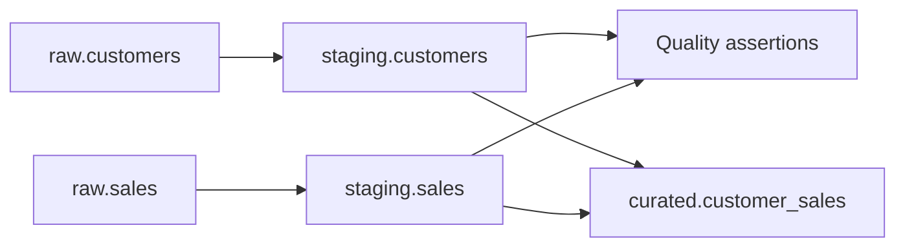

# Raw-to-curated data flow

This flow uses the typed BigQuery tables loaded by the ingestion contract in
`config/dev/ingestion.yaml`. It is intentionally SQL-only: Cloud Workflows (or
the selected orchestration trigger) owns control flow and job metadata, while
BigQuery owns transformations and quality assertions.

## Execution order

1. Load accepted `customers.csv` and `sales.csv` records into append-oriented
   `raw.customers` and `raw.sales` tables.
2. Run
   [`01_staging_customers.sql`](../../sql/transformations/01_staging_customers.sql)
   and
   [`02_staging_sales.sql`](../../sql/transformations/02_staging_sales.sql).
   These statements trim customer names and exclude records that cannot meet
   the required staging contract.
3. Run
   [`customers_and_sales.sql`](../../sql/data_quality/customers_and_sales.sql).
   Every assertion must succeed. A failed assertion must stop the workflow and
   leave the last known-good curated table unchanged.
4. Run
   [`03_curated_customer_sales.sql`](../../sql/transformations/03_curated_customer_sales.sql)
   to replace `curated.customer_sales` with one row per staged customer,
   including sale count, total amount, and last sale date.

`${GCP_PROJECT_ID}` is a deployment-time substitution token; project IDs,
locations, identities, access grants, retention, and deletion behavior remain
environment configuration rather than SQL constants. The transformation
version is the reviewed commit containing these SQL files. The source table
names and schemas are defined by the ingestion contract; consumers use the
curated dataset by default.

## Quality and failure behavior

The quality gate checks required fields, non-negative amounts, customer
referential integrity, and unique sale IDs. Staging filters malformed records,
so the ingestion/load job must retain rejected-record counts and source object
lineage for operational investigation. Curated publication is deliberately
after the gate, so a failed run does not publish partial output.

This flow applies `DATA-001`, `DATA-003`, `DATA-CON-001` through
`DATA-CON-004`, and `DATA-CLS-001` by keeping purpose, lineage, contract
validation, classification, and access boundaries explicit. Use synthetic or
approved non-production data for tests.
