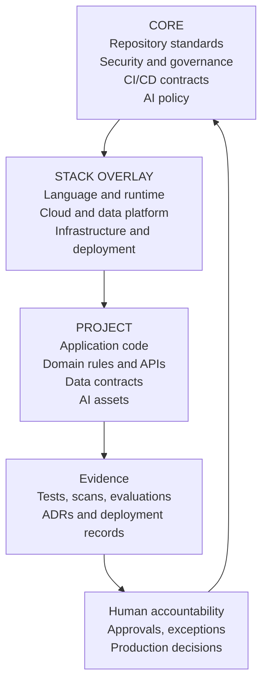

# Architecture Overview

This diagram shows the boundary between reusable repository policy, stack-specific implementation, and project-owned behavior.

## Boundary rules

- Core rules are vendor- and language-neutral.
- Stack overlays add concrete implementation without weakening core requirements.
- Project code owns domain behavior, contracts, and project-specific AI configuration.
- Evidence supports review but does not replace human accountability for exceptions, risk acceptance, or production approval.

## Delivery architecture

```mermaid
flowchart LR
    Source[Feature branch] --> PR[Pull Request]
    PR --> Gates[Build, quality, security\nand governance checks]
    Gates --> Review[CODEOWNER and\nspecialist review]
    Review --> Approval[Human approval]
    Approval --> Main[Protected main]
    Main --> Artifact[Immutable artifact]
    Artifact --> Dev[DEV]
    Dev --> Test[TEST/UAT\nautomated validation]
    Test --> ProdApproval[Production approval]
    ProdApproval --> Prod[PROD]
    Prod --> Observe[Monitoring, rollback\nand learning loop]
    Observe --> Policy[Policy or ADR update]
    Policy --> Gates
```

The current repository contains the policy, workflow, and integration-point documentation. Concrete stack builds, scanners, deployment targets, and GitHub protection settings are configured by the project overlay and administrators.
