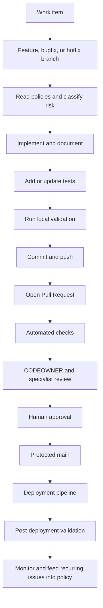

# Developer Workflow

This is the standard lifecycle for every feature or change.



```text
Work item -> branch -> policy review -> implementation -> tests -> local validation
-> commit -> push -> Pull Request -> automated checks -> review -> approval
-> merge -> deployment pipeline -> post-deployment validation
```

## Responsibilities

| Stage | Developer | Automation | AI assistance | Human |
|---|---|---|---|---|
| Plan | Select work item, risk, policies, and reviewers. | None in Phase 3. | Identify relevant policy IDs. | Confirm scope for high-risk work. |
| Develop | Implement, test, document, and disclose impact. | Local scripts provide checks. | Suggest code or risks; do not approve. | Answer design and risk questions. |
| PR | Complete template and link evidence. | Future gates run deterministic checks. | Review architecture, security, DevOps, or AI concerns. | CODEOWNER and specialist review. |
| Merge | Resolve feedback and keep branch current. | Required checks report status. | Cannot merge or override controls. | Approve and merge through protected branch. |
| Deploy | Provide release and rollback context. | Future pipeline promotes artifacts. | Analyze signals and suggest action. | Approve production and exceptions. |
| Operate | Monitor and respond through runbooks. | Collect health and deployment evidence. | Summarize incidents or recurring issues. | Own incident, risk, and policy decisions. |

## Local sequence

1. Run `bash scripts/setup.sh` for a new project and review `PROJECT.yaml`.
2. Create a correctly named branch from current `main`.
3. Read applicable policies and record principle IDs in the PR when material.
4. Implement the smallest reviewable change and add or update tests.
5. Run `bash scripts/check.sh`. Run `bash scripts/validate-baseline.sh` with `CHANGED_FILES_FILE` set to see baseline impact.
6. Commit using the contribution guide, push, and open a PR.
7. Respond to automated, AI-assisted, CODEOWNER, and specialist review.
8. Merge only after required human approvals and checks pass.
9. Follow deployment and post-deployment validation guidance for released changes.

## Architecture baseline

Normal change: developer, PR, CI, review, merge. If the PR touches an approved boundary in `docs/architecture/baseline.yaml`, the Baseline Guard in CI reports the classification:

| Classification | Meaning | What happens |
|---|---|---|
| `NO_BASELINE_IMPACT` | No approved boundary touched | Normal PR workflow. |
| `BASELINE_IMPACT` | An approved boundary is touched | Output names the boundary, relevant agents, and owners; review is required, CI does not fail. |
| `ARCHITECTURE_CHANGE` | Approved decision may be altered | Add an ADR (`Baseline impact: change`); CI fails without one once the baseline is `approved`. |

Agent = recommendation, CI = deterministic enforcement, human = architectural decision authority. Declare the classification in the PR template.

## Automation Candidates

| Candidate | Principle ID | Future component | Mode | Trigger | Human approval | Phase |
|---|---|---|---|---|---|---|
| Policy-ID discovery | RP-005 | Governance check | Deterministic | PR diff | No | 4 |
| Change-risk suggestion | DEVOPS-PR-004 | Risk assistant | AI-assisted | PR opened | Reviewer | 6 |
| Required approval routing | DEVOPS-PR-002 | Review policy | Deterministic | PR state | Human approver | 4 |
